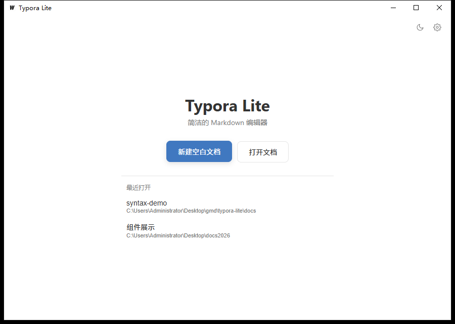
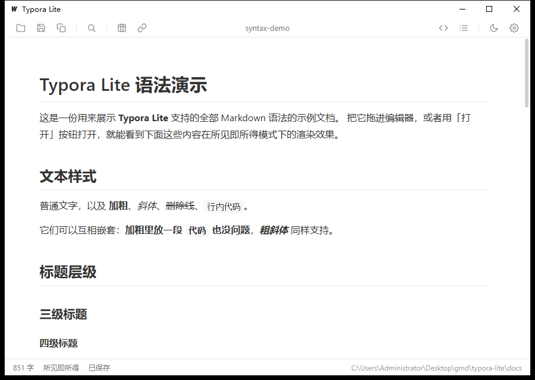
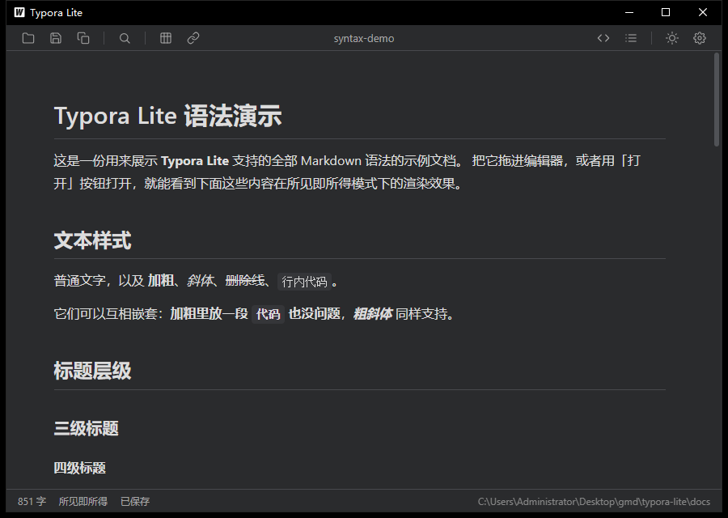
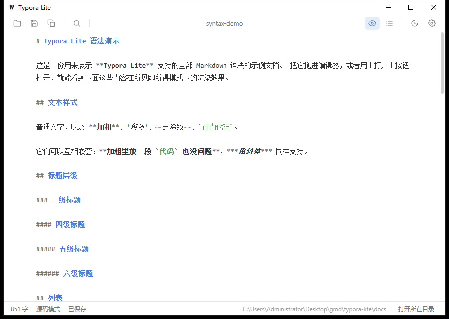
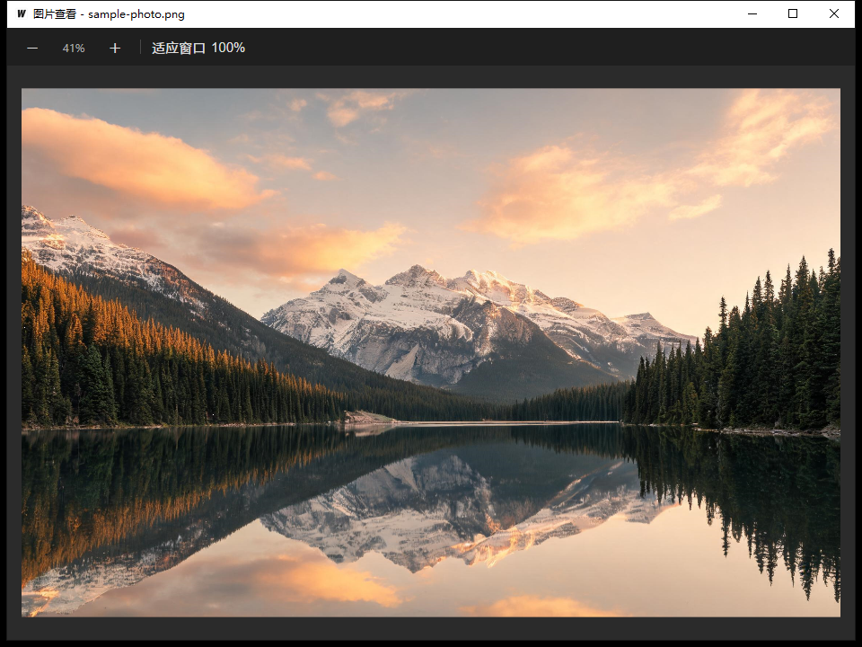

# LiteMark View

一个用 **Go + Wails + Tiptap** 实现的轻量级 Markdown 编辑器，界面与交互参考主流所见即所得编辑器：
顶部单行菜单栏 + 居中纸张排版，所见即所得编辑，随时切到源码模式查看/修改文件原文。



## 界面预览

| 所见即所得（亮色） | 所见即所得（暗色） |
| --- | --- |
|  |  |

源码模式（CodeMirror 6，直接显示磁盘上的原始文本，带 Markdown / 代码语法高亮）：



图片查看器（滚轮缩放、拖拽平移、适应窗口 / 原始尺寸）：



## 功能

- **所见即所得编辑**：基于 Tiptap（ProseMirror），标题、加粗、列表、表格、代码块等都是真实渲染的排版。
- **原地展开 Markdown 原文**：光标贴进行内格式（加粗、斜体、删除线、行内代码、链接）时，自动展开成真实的 `**粗体**`、`` `代码` `` 等字符；光标离开后自动收回。支持嵌套（如 `**加粗里的 \`代码\`**`、`***粗斜体***`）。
- **源码模式**：使用 CodeMirror 6，直接读写文件原文，不做「渲染结果再序列化」的往返转换；在源码里改过内容，切回所见即所得时会用原文重新解析，保证两种视图始终一致。
- **双向切换保持阅读位置**：切换时按当前视口约 1/3 处正在看的内容做行 ↔ 块映射，光标和滚动都会跟过去，而不是跳到光标所在处。
- **查找 / 替换**：Ctrl+F / Ctrl+H，所见即所得和源码模式都可用；支持区分大小写、全词匹配、正则表达式。
- **代码块语法高亮**：lowlight（highlight.js 词库），支持 20+ 语言，右上角可切换语言、一键复制。
- **图片**：粘贴、拖拽图片自动落盘到资源目录，可右键放大查看（详见下一节）。
- **大纲目录**：右侧可折叠面板；源码模式下按纯文本里的 `#` 行定位。
- **明暗主题**：整套配色（含自绘标题栏）随之切换。
- **单行标题栏**：窗口为无边框自绘，功能按「文件(F) / 编辑(E) / 插入(I) / 视图(V)」收进文字下拉菜单（支持 `Alt` + 字母直接展开）；右侧保留源码模式、大纲、主题、设置四个图标和最小化 / 最大化 / 关闭按钮，中间点击文档名可重命名。标题栏空白处可拖动窗口、双击切换最大化。关闭按钮与原生 `Alt+F4` 一样会先处理未保存内容再询问退出方式。
- **文件能力**：打开 / 保存 / 另存为、标题栏点击重命名、2 秒防抖自动保存、最近打开、启动页、拖拽 `.md` 打开、注册 `.md` 文件关联、系统托盘常驻（**双击托盘图标**可直接打开 / 唤出主窗口）。
- **打开行为**：停在启动页时，打开文档 / 最近打开 / 拖入 `.md` 都直接**使用当前窗口**；已经打开文档后，再打开任何 `.md`（含双击文件关联）一律在**新窗口**，不会覆盖当前内容。设置里不再有「当前窗口 / 新窗口」选项，也不会弹询问框。
- **窗口尺寸**：启动页是一个 460×500 的小窗口，进入编辑（打开或新建文档）后自动恢复 900×640；关闭到后台再唤出、回到启动页时也会缩回小窗口。
- **状态栏**：字数、当前模式、保存状态、文件所在目录，以及一键「打开所在目录」在系统文件管理器中定位当前文件。

## 图片

### 插入

- 直接把图片文件拖进编辑器，或粘贴截图 / 图片文件：图片会复制到资源目录，并在 Markdown 中写入引用路径。
- 从网页复制图片粘贴时，会自动下载到本地资源目录，避免文档依赖外部链接。
- 资源位置可在「设置」中切换：**相对路径**（存到文档同级资源文件夹，Markdown 里写相对路径）或**自定义目录**（统一存放，写绝对路径）。
- 网络图片地址（``）同样可以直接显示。

### 放大查看

在编辑器里对图片点右键，可以：

- **查看图片**：用独立窗口打开图片查看器，适合查看大图、细节截图。
- **打开图片所在目录**：在资源管理器中定位图片文件。

图片查看器支持的交互：

| 操作 | 效果 |
| --- | --- |
| 鼠标滚轮 | 以光标所在位置为中心缩放（5% ~ 4000%） |
| 按住左键拖动 | 平移图片 |
| 工具栏 `－` / `＋` | 以窗口中心缩放 |
| 工具栏「适应窗口」 | 按窗口大小等比缩放并居中 |
| 工具栏「100%」 | 恢复原始像素尺寸 |
| 双击图片 | 在「适应窗口」与「原始尺寸」之间切换 |
| 调整窗口大小 | 自动重新适应窗口 |


## 支持的语法

完整的示例文档见 [docs/syntax-demo.md](docs/syntax-demo.md)，直接拖进编辑器即可查看渲染效果。

| 元素 | 语法 | 说明 |
| --- | --- | --- |
| 标题 | `#` ~ `######` | 支持 1~6 级标题 |
| 加粗 | `**文字**` | 光标进入时展开为源码 |
| 斜体 | `*文字*` | 可与加粗嵌套 |
| 粗斜体 | `***文字***` | |
| 删除线 | `~~文字~~` | |
| 行内代码 | `` `代码` `` | 可以嵌套在加粗里 |
| 代码块 | ``` ```lang ``` | 带语法高亮，可切换语言 |
| 链接 | `[名称](地址)` | 粘贴纯 URL 也会自动转成链接 |
| 图片 | `` | 支持本地路径与网络地址 |
| 无序列表 | `- 项` | 支持嵌套 |
| 有序列表 | `1. 项` | |
| 任务列表 | `- [ ]` / `- [x]` | 可点击勾选 |
| 表格 | `\| 列 \| 列 \|` | 支持拖动调整列宽、右键增删行列 |
| 引用 | `> 文字` | |
| 分隔线 | `---` | |

不支持 Markdown 扩展语法（如高亮 `==文字==`、脚注、公式）。

## 快捷键

| 快捷键 | 功能 |
| --- | --- |
| `Ctrl + S` | 保存 |
| `Ctrl + O` / `Ctrl + Shift + O` | 打开文件（启动页用当前窗口，已有文档时新窗口） |
| `Ctrl + F` | 查找 |
| `Ctrl + H` | 查找 / 替换 |
| `Ctrl + /` | 切换源码模式 / 所见即所得 |
| `Enter` / `Shift + Enter` | 查找面板中跳到下一个 / 上一个匹配 |

## 构建

依赖：Go 1.26+、Node.js 20+、[Wails v2 CLI](https://wails.io/)。Windows 另需 WebView2 运行时（Win10/11 一般已自带）。**官方 Release 只发布 Windows x64 安装包**；macOS 版不随发版分发，如有需要可本地自行构建（需 Xcode 命令行工具，仅支持 Apple Silicon）。

```bash
go install github.com/wailsapp/wails/v2/cmd/wails@v2.17.1

cd frontend && npm install && cd ..

wails build -platform windows/amd64   # Windows：build/bin/LiteMarkView.exe（官方发行版）
wails build -platform darwin/arm64    # macOS：  build/bin/LiteMarkView.app（仅本地自行构建）
wails dev                            # 开发模式（前端热更新）
```

本地构建的 macOS 版为 ad-hoc 签名、未做公证，首次打开若被 Gatekeeper 拦截，可在终端执行 `xattr -cr /Applications/LiteMarkView.app`，或右键应用 → 打开。

## 自动打包与发版

仓库内置 GitHub Actions 工作流 [.github/workflows/release.yml](.github/workflows/release.yml)。**日常 push / PR 不触发任何构建**，只有推送 `v*` 版本标签（或在 Actions 里手动指定已有标签重跑）才会打包并发布 Release。

每次发版只构建 Windows x64，产物自动附加到该标签的 Release：

| 平台 | 产物 | 说明 |
| --- | --- | --- |
| Windows x64 | `LiteMarkView.exe` | 单文件，双击运行 |

> 不再产出 macOS 安装包；如需 mac 版请按上文本地构建。

发版步骤：先把 `wails.json` 的 `productVersion` 改成新版本号并提交，然后打标签推送：

```bash
git tag v0.23.0
git push origin v0.23.0
```

工作流会先创建 Release（自动生成更新说明），再上传 Windows 安装包。若构建失败，在 Actions 里对同一标签手动重跑即可，产物会覆盖上传，无需重新打标签。

## 目录结构

```
litemark-view/
├─ app.go                # Wails 绑定：文件读写、图片存储、设置
├─ main.go               # 窗口、托盘、单实例、图片查看器
├─ platform_windows.go   # 注册表文件关联、托盘 ico、资源管理器定位
├─ platform_darwin.go    # Finder 定位、托盘 PNG、macOS 文件关联说明
├─ recent.go / settings.go
├─ frontend/
│  ├─ index.html
│  ├─ viewer.html        # 独立图片查看器窗口
│  └─ src/
│     ├─ main.js         # 模式切换、源码模式（CodeMirror 6）、查找替换、大纲
│     ├─ editor.js       # Tiptap 扩展、行内源码展开/收回、代码块高亮
│     ├─ viewer.js       # 图片查看器：缩放、平移、适应窗口
│     └─ style.css       # 主题与排版
├─ docs/
│  ├─ syntax-demo.md     # 全量语法示例（用于截图与自查）
│  └─ images/            # README 截图与示例图片
└─ .github/workflows/release.yml
```

## 已知限制

- 官方 Release 仅提供 Windows x64 安装包；macOS Apple Silicon（arm64）只支持本地自行构建，不随发版分发；不提供 Intel Mac / Linux 安装包。
- 本地构建的 macOS 版未做开发者签名与公证，首次打开需手动允许；文件关联需在 Finder 的「打开方式」里手动选择（设置面板的「注册」会给出步骤）。
- 源码模式不做实时双向同步：在源码里修改后切回所见即所得时才会重新解析，以保证内容始终是文件原文。
- 高亮（`==文字==`）、脚注、数学公式等常见 Markdown 扩展语法未实现。
